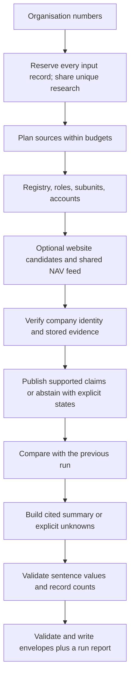

# The agent loop

Signalpost is a tool-using company-research agent. Source planning, identity verification, publication and template summaries use deterministic rules.

For each company:

1. Normalize the nine-digit organisation number and verify its mod-11 checksum. Reserve its output before requests. Invalid inputs retain failed envelopes without network access.
2. Plan identity lookup from the supplied bulk snapshot first, then the official live endpoint if absent. Read roles, subunits and exact-company annual accounts after identity succeeds.
3. When enabled, generate bounded website candidates from registry website/email and legal-name slugs. Fetch under robots, public-IP, timeout and request policies. Await the shared NAV index only at the hiring step; waiting releases registry worker slots.
4. Verify exact company/parent identifiers. Website corroboration can qualify only under the documented identity rules. Link claims to exact stored source bodies, locators and short verbatim spans.
5. Publish verified values, or an explicit availability state and null. Each source section and company is isolated. A global deadline preserves completed claims and marks incomplete work failed.
6. Compare supported values with the supplied previous envelopes. Separate company changes from observation failures, retaining non-expired prior supported facts when appropriate.
7. Build a template summary of activity, scale, leadership, changes and unknowns. Quote registered activity/purpose and accepted-site self-descriptions. Read website description tags and already-fetched about paragraphs without additional requests.
8. Check citations, evidence, identity thresholds, verbatim quotes and value tokens. Derived counts must equal distinct cited records of the declared type. Drop rejected sentences and explain empty sections. Synthesis never adds source claims, changes company events or turns a source envelope into a failure.

`--synthesis template` is the default; `auto` maps to the same deterministic templates. The CLI rejects `llm` with an argument error. No language model is called. A baseline summary includes the first-observation notice; reproducibility compares identical source claims, changes and prior-snapshot context.

The final writer preserves input order and input-record multiplicity, validates every envelope and the whole output, and publishes atomically. Research is shared for duplicates; `--deduplicate` explicitly emits unique identifiers. Exit zero means output was written; it does not mean every source succeeded.

See [identity rules](IDENTITY_RESOLUTION.md), [schema](DATA_SCHEMA.md), [refresh semantics](REFRESH.md) and [evaluation](EVAL.md).

## Bounded recall and public activity

Nominated and guessed domains use cached DNS checks and the bounded public-resolver recovery retained from Step 8. DNS failures spend no HTTP request; failed nominated sources remain explicit incomplete checks. Registry/email/subunit, exact-employer NAV, Wikidata and already-held annual-report candidates precede at most four spelling guesses. Guesses are skipped for investment, holding and housing-association names. Discovery stops after ownership proof. Connection-time public-IP checks remain mandatory. Requests share a global 18/input pool with a hard 40/company ceiling; time limits and lower explicit caps remain effective.

NAV headers are ranked by distinctive-token overlap, with rare tokens weighted more heavily across the current feed. Legal suffixes and Norwegian/ASCII spelling variants affect discovery only. Details are fetched in rank order, including retries, within a configurable cap defaulting to min(candidate ads, max(300, 2 × unique companies)). Unchecked affected candidates remain failed; only exact company/listed-subunit employer numbers authorize publication.

With `--public-activity`, an accepted current website can supply news links from same-domain RSS/Atom feeds and sitemaps. Discovery follows at most one sitemap-index level; publication requires a fetched article containing datePublished or a time tag. Feed dates and lastmod never establish publication. Author, category/tag and bare news-listing paths are excluded. Recent evidence-backed registry dates use no new requests. Tier B registry-declared links cannot supply content, jobs, news or social. Site presentation and synthesis retain explicit source states and cite the original evidence.
